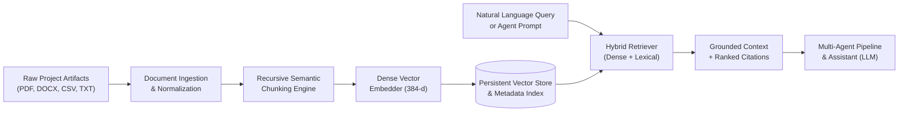
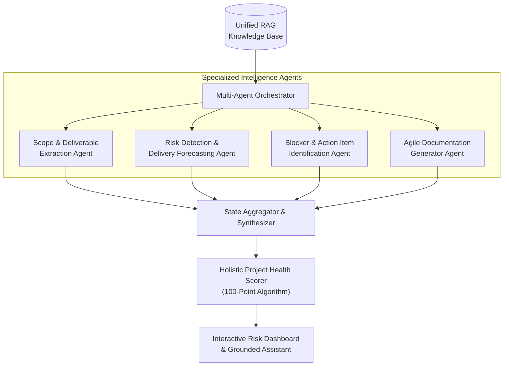
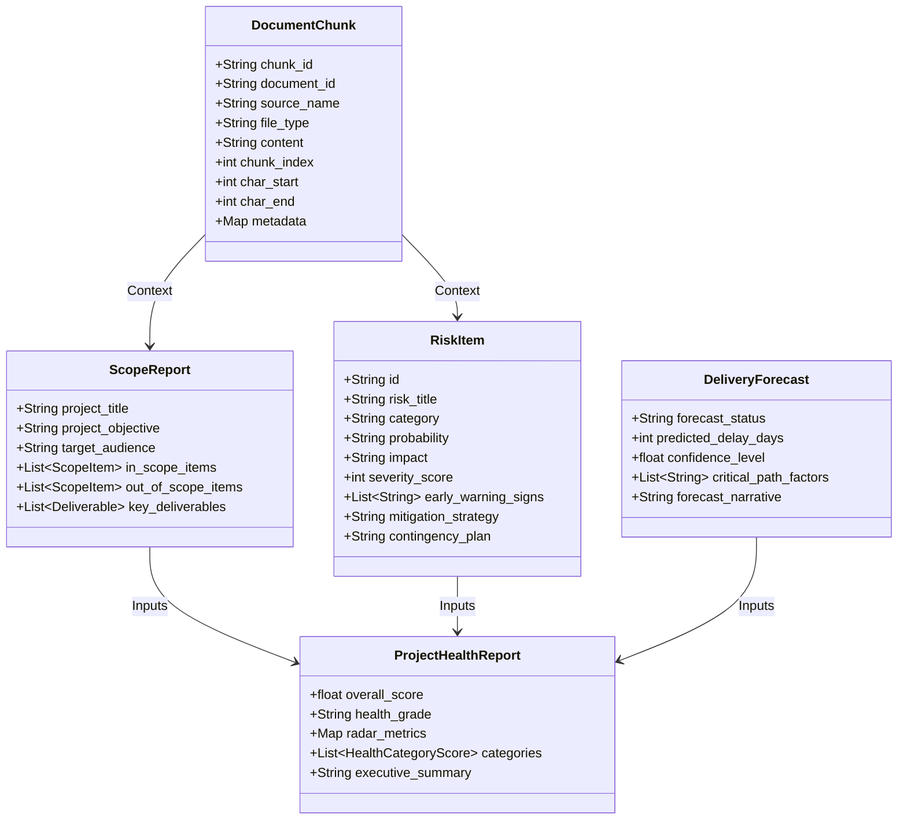

# AI Project Intelligence & Risk Advisor
## System Architecture & Milestone 1 Design Specification

**Document Version:** 1.0.0  
**Phase:** Milestone 1 (Week 1–2: Ingestion & RAG Foundation)  
**Author:** AI Project Intelligence Team  

---

## 1. Study of RAG Architecture & Multi-Agent Design Patterns

### 1.1 Retrieval-Augmented Generation (RAG) Architecture
Project artifacts generated by software engineering teams are heterogeneous, fragmented, and asynchronous (e.g., Proposals in PDF, Requirements in Word/DOCX, Backlogs in CSV, Meeting Notes in TXT, Sprint updates in Markdown). Traditional keyword search fails to bridge the conceptual gap between high-level project goals and granular sprint blockers.

#### Key RAG Components:
1. **Multi-Format Document Parsing:**
   - **PDF:** Layout-aware extraction using `pdfplumber` and `PyPDF2`, converting tabular structures into structured text representations.
   - **DOCX:** Structural parsing with `python-docx`, maintaining heading hierarchy (`H1`, `H2`, `H3`), lists, and tabular matrices.
   - **CSV:** Tabular record conversion via `pandas`, converting rows into semantically enriched key-value records for vector embedding.
   - **Plain Text / Markdown:** Preserving bullet points, action items, dates, and speaker attributions.

2. **Recursive Character Chunking Strategy:**
   - Chunk Size: 500 characters with 80 character overlap.
   - Hierarchical splitting hierarchy: `["\n\n", "\n### ", "\n## ", "\n# ", "\n- ", "\n", ". ", " "]`.
   - Attaches provenance metadata to every chunk: `document_id`, `chunk_id`, `source_name`, `file_type`, `char_start`, `char_end`.

3. **Hybrid Retrieval (Dense Semantic + Lexical BM25 Boost):**
   - Dense embeddings capture semantic intent (e.g., matching "schedule slip" with "milestone delay").
   - Lexical keyword matching ensures strict preservation of acronyms, ticket IDs (e.g., `TSK-103`), and named entities.
   - Combined scoring: $\text{Score}_{\text{hybrid}} = 0.7 \cdot \text{Score}_{\text{dense}} + 0.3 \cdot \text{Score}_{\text{lexical}}$.

---

## 2. Multi-Agent Design Patterns

The system implements an **Orchestrator-Workers Sequential Pipeline Pattern** where specialized agents operate on grounded knowledge base context and hand off enriched state to downstream modules:

### Agent Roles & Specifications:

| Agent Name | Primary Responsibility | Input Context | Output Artifact |
|---|---|---|---|
| **Scope & Deliverable Agent** | Extracts core objectives, in-scope deliverables, out-of-scope boundaries, target deadlines. | Proposals, SRS, Backlogs | `ScopeReport` (In-Scope, Out-of-Scope, Deliverables) |
| **Risk & Forecasting Agent** | Detects technical, schedule, dependency, and resource vulnerabilities; calculates 1–25 severity scores. | Sprint notes, Risk logs, Architecture specs | `List[RiskItem]`, `DeliveryForecast` |
| **Blocker & Action Agent** | Detects immediate impediments, stalled tasks, owners, and concrete mitigation steps. | Standup notes, retrospectives, issue lists | `List[BlockerItem]`, `List[ActionItem]` |
| **Documentation Generator Agent** | Synthesizes missing Agile user stories in canonical format and identifies documentation gaps. | Requirements, use cases, notes | `DocumentationBundle` (User Stories, Gaps) |
| **Project Health Scorer** | Evaluates overall project health across 5 weighted dimensions. | Outputs of all 4 agents | `ProjectHealthReport` (0–100 Score, Radar Metrics) |

---

## 3. Project Management Fundamentals & Scoring Rubric

### 3.1 Quantitative Risk Matrix (Probability $\times$ Impact)
Risks are evaluated using a $5 \times 5$ matrix scoring formula:
$$\text{Severity Score} = \text{Probability (1–5)} \times \text{Impact (1–5)}$$

- **Critical / High (15–25):** Red zone. Threatens delivery milestone; requires immediate architectural mitigation and contingency planning.
- **Moderate (8–14):** Amber zone. Sprint velocity pressure; monitored in sprint planning.
- **Low (1–7):** Green zone. Routine maintenance.

### 3.2 Holistic 100-Point Project Health Score Formula
The project health score is computed across five weighted dimensions:

$$\text{Overall Health} = \sum_{i=1}^5 W_i \cdot S_i$$

1. **Planning & Scope Definition ($W_1 = 0.20$):** Clarity of deliverables, milestone definition, and explicit out-of-scope boundaries.
2. **Timeline & Schedule Adherence ($W_2 = 0.25$):** Penalties applied based on forecasted delay days ($\text{Delay} \times 3.5$) and critical path bottlenecks.
3. **Risk Exposure & Mitigation ($W_3 = 0.25$):** Density of high-severity risks ($S \ge 15$) and coverage of mitigation plans.
4. **Documentation Completeness ($W_4 = 0.15$):** User story coverage, acceptance criteria detail, and missing technical documentation gaps.
5. **Blocker & Impediment Resolution ($W_5 = 0.15$):** Open critical blockers ($-20$ pts each) and high blockers ($-10$ pts each).

#### Health Grading Scale:
- **Grade A (85.0 – 100.0):** Excellent health. Milestones on track.
- **Grade B (70.0 – 84.9):** Good health. Minor schedule variance, manageable risks.
- **Grade C (50.0 – 69.9):** At Risk. Critical blockers or elevated delay requiring intervention.
- **Grade D (< 50.0):** Critical. Immediate leadership triage required.

---

## 4. Document Data Models

---

## 5. Milestone 1 Verification Checklist

- [x] Multi-format Ingestion Module supporting PDF, DOCX, CSV, TXT, MD.
- [x] Recursive Document Chunker with configurable overlap and metadata tags.
- [x] Sub-word character/word n-gram Embedder with local/SentenceTransformers support.
- [x] Persistent Vector Store with normalized cosine similarity search and index saving.
- [x] Hybrid Retriever with dense + lexical keyword boosting.
- [x] Scope & Deliverable Extraction Agent.
- [x] Risk Detection & Schedule Forecasting Agent.
- [x] Blocker & Action Item Identification Agent.
- [x] Documentation Generation Agent (Agile User Stories & Gap Detection).
- [x] 100-Point Holistic Project Health Scoring Algorithm.
- [x] RAG-Grounded Conversational Assistant with citations.
- [x] Interactive Single-Page Dashboard with Charts, Dropzone, and Real-time Controls.
- [x] 18 Automated Unit and Integration Tests passing with 100% success rate.
